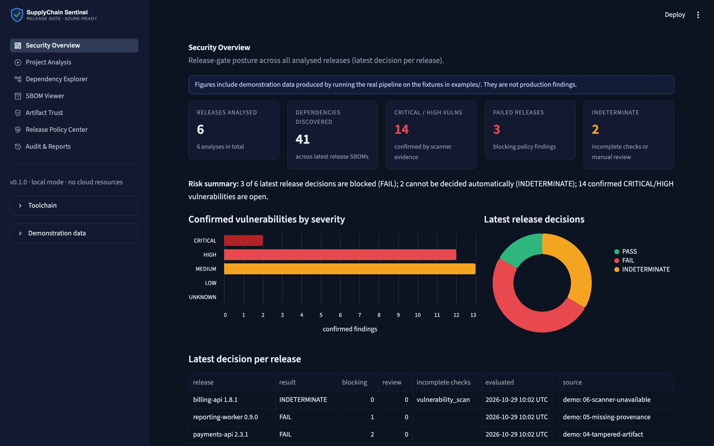
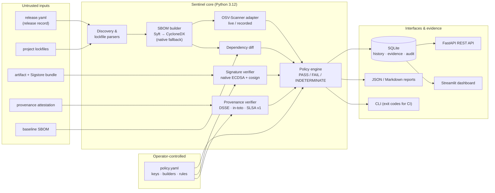
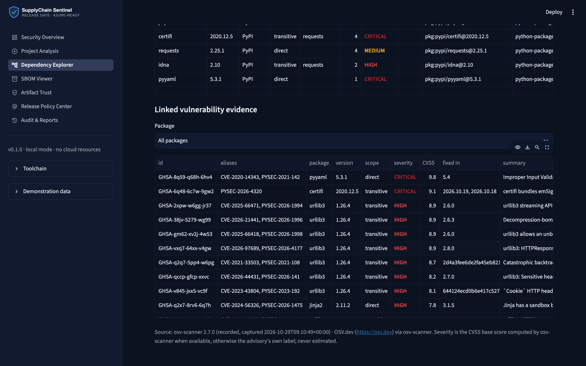
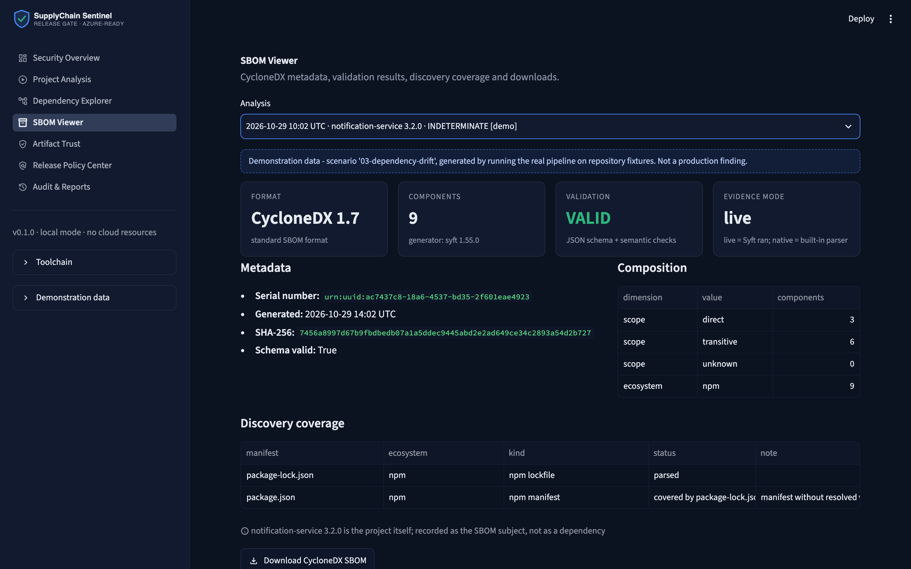
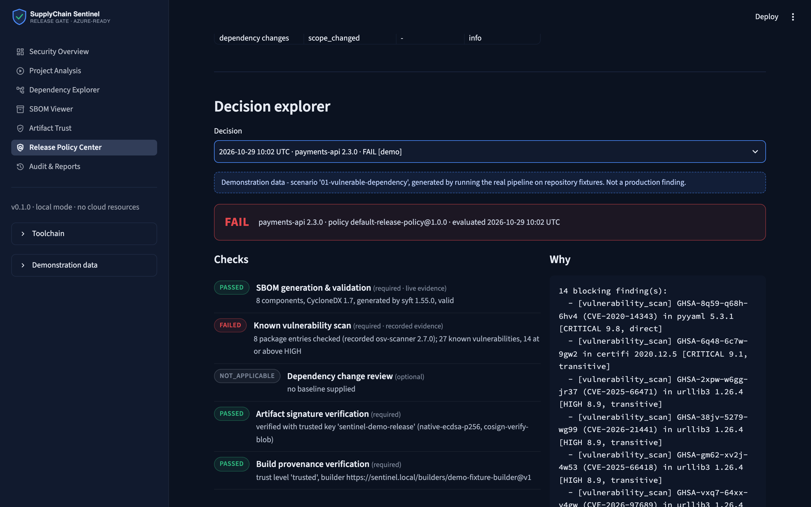
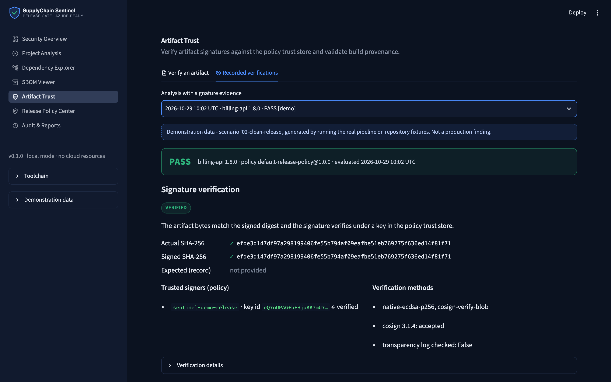
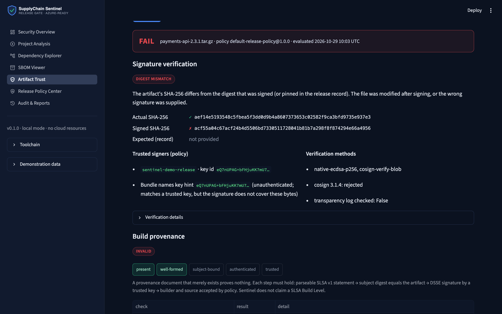
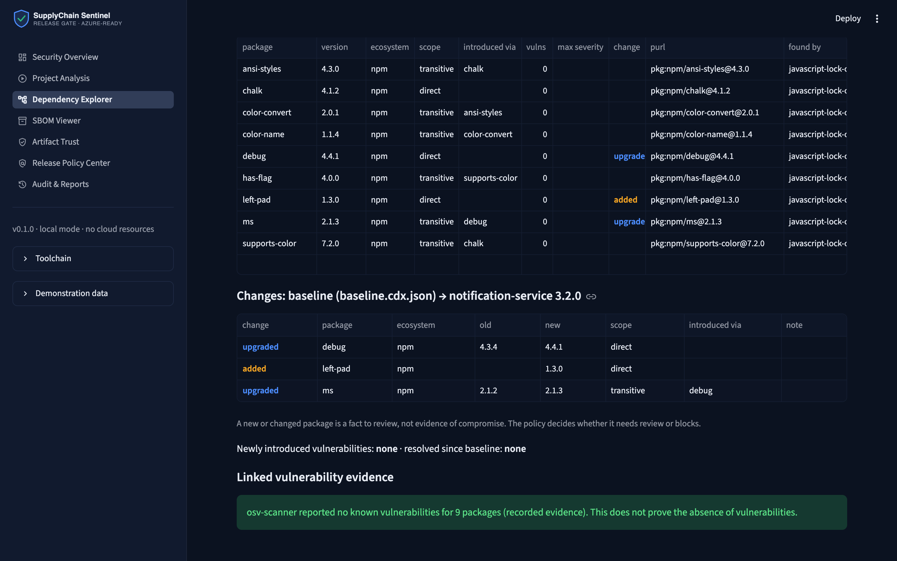

# Azure SupplyChain Sentinel

[](https://github.com/ahmedhany-cys/azure-supplychain-sentinel/actions/workflows/ci.yml)


**A software supply-chain release gate.** Sentinel inventories an application's dependencies
(CycloneDX SBOM via Syft), checks them against known vulnerabilities (OSV-Scanner), compares
them with a baseline, verifies the release artifact's signature (Cosign-compatible Sigstore
bundles) and its build provenance (in-toto / SLSA v1, DSSE-signed), and turns all of that
evidence into an auditable **PASS / FAIL / INDETERMINATE** decision under a versioned policy.

It runs entirely on a laptop or in CI with no cloud spend. An optional, off-by-default Azure
footprint (Terraform) is provided for teams that want hosted evidence storage, a registry and a
Key Vault-backed signing key.



---

## Contents

- [Why this exists](#why-this-exists) · [What it answers](#what-it-answers) · [Architecture](#architecture)
- [Features](#features) · [Quick start](#quick-start) · [Demonstration scenarios](#demonstration-scenarios)
- [Screenshots](#screenshots) · [CLI, API and dashboard](#cli-api-and-dashboard) · [Testing](#testing)
- [CI/CD](#cicd) · [Azure](#azure-optional) · [Security model](#security-model) · [Limitations](#known-limitations) · [Roadmap](#roadmap)

## Why this exists

A company is about to ship a service to production. One developer pinned a third-party library
with a publicly known critical vulnerability. Another dependency update quietly changed several
transitive packages. The build pipeline produces an artifact, but nobody can show which
components it contains, whether the file being deployed is the file that was built, or how and
from which source it was built.

The organisation needs a **repeatable gate** that answers those questions from evidence and
refuses to guess when evidence is missing.

## What it answers

| Question | Evidence | Control |
|---|---|---|
| Which components are in this application? | CycloneDX SBOM (Syft, or the built-in lockfile parser), schema-validated | `sbom` check |
| Which known vulnerabilities or unexpected changes need attention? | OSV-Scanner results normalised with aliases, CVSS score source and fixed versions; baseline diff | `vulnerability_scan`, `dependency_diff` checks |
| Can the artifact be verified against a trusted signer? | Sigstore bundle verified over the artifact's actual SHA-256 under a key from the policy trust store; Cosign cross-check | `artifact_signature` check |
| Is there verifiable evidence of how it was built? | DSSE-signed in-toto statement with a SLSA v1 predicate bound to the artifact digest, trusted builder, matching source revision | `provenance` check |
| Should the release pass? | Policy decision with policy version and hash, per-check status, findings, evidence digests and human-readable reasons | release decision |

Sentinel deliberately separates **confirmed findings** (reported by a scanner), **suspicious
indicators** (a new dependency, an identifier change) and **policy decisions**. A new package is
never labelled malicious, an unrated advisory is never treated as low, and a scanner that
timed out never produces a clean result.

## Architecture



Every external tool is invoked through one hardened runner (argv lists, no shell, hard timeouts,
minimal environment, size-capped and secret-redacted output). Details: [docs/architecture.md](docs/architecture.md).

## Features

- **SBOM generation and validation** - Syft 1.55 CycloneDX output (1.7) or a built-in CycloneDX 1.6
  generator; JSON-schema validation via `cyclonedx-python-lib` plus semantic checks (duplicate
  `bom-ref`s, dangling dependency references, unparseable purls). Direct vs transitive scope comes
  from pip-compile annotations, `package-lock.json` v2/v3 and `poetry.lock` + `pyproject.toml`;
  when it cannot be determined it is reported as `unknown`. Unsupported manifests are listed, and
  build scripts (`setup.py`, Gradle) are never executed.
- **Vulnerability evidence** - OSV-Scanner 2.x adapter with advisory grouping (GHSA/PYSEC/CVE
  aliases reported once), severity from osv-scanner's CVSS base score or the advisory's own label
  (source recorded), fixed versions from the advisory ranges, and scan status
  (`completed`, `timeout`, `unavailable`, `error`, `no_packages`). Live and **recorded** modes;
  recorded evidence is labelled everywhere it appears.
- **Dependency drift** - added, removed, upgraded, downgraded, identifier-changed (same version,
  different purl) and scope-changed packages, plus newly introduced / resolved vulnerabilities when
  both scans are comparable. Allow-list and deny-list rules.
- **Artifact signing** - verifies Cosign 3.x key-based Sigstore bundles natively (ECDSA P-256)
  and, when Cosign is installed, requires `cosign verify-blob` to agree (fail closed on
  disagreement). Tampered files, forged digest fields, untrusted signers, malformed bundles and
  keyless bundles are each reported distinctly. Encrypted local development keys (`sentinel keygen`).
- **Build provenance** - DSSE envelopes or Sigstore DSSE bundles carrying in-toto statements with
  SLSA v1 predicates. Reports the trust level reached: present → well-formed → subject-bound →
  authenticated → trusted.
- **Policy engine** - YAML policy with strict schema, required checks, severity threshold,
  expiring risk exceptions, change rules and configurable outcomes for missing evidence and
  manual review. Decisions record the policy version and SHA-256.
- **Interfaces** - CLI with CI-friendly exit codes, FastAPI REST API (OpenAPI at `/docs`),
  seven-page Streamlit dashboard, SQLite history, JSON/Markdown reports, audit log.

## Quick start

Requirements: Python 3.12 or 3.13. Optional but recommended: [Syft](https://github.com/anchore/syft),
[OSV-Scanner](https://github.com/google/osv-scanner) and [Cosign](https://github.com/sigstore/cosign)
on `PATH` (for example `brew install syft osv-scanner cosign`). Without them Sentinel uses its
native SBOM generator and signature verifier, and live vulnerability scans report `unavailable`
(never clean).

```bash
git clone https://github.com/ahmedhany-cys/azure-supplychain-sentinel.git
cd azure-supplychain-sentinel
python3.12 -m venv .venv && source .venv/bin/activate
make install          # hash-checked install from requirements/requirements-dev.txt
sentinel demo --check # run the six scenarios and verify their decisions
```

Then start the interfaces:

```bash
sentinel demo --store                       # store the scenarios as demonstration data
streamlit run sentinel/dashboard/app.py     # dashboard on http://localhost:8501
python -m sentinel.api                      # API on http://127.0.0.1:8000/docs
```

Or with Docker (API on `127.0.0.1:8000`, dashboard on `127.0.0.1:8501`):

```bash
docker compose up --build
```

## Demonstration scenarios

Six reproducible scenarios live in [`examples/`](examples/). Each has a release record, a project,
a deterministic tarball signed with a demo key whose **private half was destroyed** after signing,
and (where relevant) provenance and recorded OSV-Scanner output. `sentinel demo --check` runs in CI.

| # | Scenario | Expected | What produces the result |
|---|---|---|---|
| 01 | Vulnerable dependency | **FAIL** | PyYAML 5.3.1 (CVE-2020-14343, CRITICAL 9.8), urllib3 1.26.4 and others at or above HIGH |
| 02 | Clean release | **PASS** | Valid SBOM, no known vulnerabilities in the recorded scan, signature and provenance verified |
| 03 | Unexpected dependency change | **INDETERMINATE** | `left-pad` added without approval (review); `debug` 4.3.4→4.4.1 and transitive `ms` 2.1.2→2.1.3 recorded |
| 04 | Tampered artifact | **FAIL** | Tarball rebuilt after signing: digest ≠ signed digest ≠ pinned digest; provenance subject no longer matches |
| 05 | Missing provenance | **FAIL** | Correctly signed, but the policy requires provenance and none was supplied |
| 06 | Scanner unavailable | **INDETERMINATE** | Fault injection: osv-scanner replaced by a stub that never answers; 3 s timeout; incomplete scan ≠ clean |

Full walkthrough: [docs/demo-scenarios.md](docs/demo-scenarios.md). Sample reports produced by the
real pipeline: [docs/sample-reports/](docs/sample-reports/).

```text
$ sentinel gate examples/04-tampered-artifact/release.yaml
payments-api 2.3.1: FAIL  (policy default-release-policy@1.0.0, id rel-…)
  PASSED         SBOM generation & validation [required] - 6 components, CycloneDX 1.7, generated by syft 1.55.0, valid
  PASSED         Known vulnerability scan [required] - 6 package entries checked (recorded osv-scanner 2.7.0); 0 known vulnerabilities, 0 at or above HIGH
  NOT_APPLICABLE Dependency change review [optional] - no baseline supplied
  FAILED         Artifact signature verification [required] - rejected: digest_mismatch
  FAILED         Build provenance verification [required] - rejected: invalid (trust level 'well-formed')
```

## Screenshots

All screenshots are of the application running locally against the demonstration scenarios,
captured with [`scripts/capture_screenshots.py`](scripts/capture_screenshots.py) (Playwright
driving Chrome). Scenario data is labelled as demonstration data in the UI.

| | |
|---|---|
|  **Dependency Explorer** - vulnerable packages with scope, linked OSV advisories, CVSS and fixed versions (scenario 01). |  **SBOM Viewer** - CycloneDX 1.7 from Syft, validation, scope composition and discovery coverage (scenario 03). |
|  **Release Policy Center** - a FAIL decision with per-check status and the exact blocking findings. |  **Artifact Trust** - signature verified over the actual digest by the native verifier and Cosign. |
|  **Tampered artifact rejected** - uploaded through the form; digest mismatch, Cosign also rejects, provenance stops at "well-formed". |  **Dependency diff** - added and upgraded packages versus the baseline SBOM (scenario 03). |

A GitHub Actions screenshot will be added once the repository is published and the workflow has run.

## CLI, API and dashboard

```bash
sentinel gate examples/02-clean-release/release.yaml --out evidence/   # exit 0 PASS / 1 FAIL / 2 INDETERMINATE
sentinel scan path/to/project                     # source-only SBOM + live vulnerability scan
sentinel sbom path/to/project -o sbom.cdx.json    # generate and validate an SBOM
sentinel validate-sbom sbom.cdx.json
sentinel diff baseline.cdx.json candidate.cdx.json
sentinel verify app.tar.gz --bundle app.tar.gz.sigstore.json [--provenance prov.json]
sentinel keygen && sentinel sign app.tar.gz --key .sentinel/keys/sentinel-dev.key
sentinel policy                                   # active policy and trust anchors
```

REST API (selected): `POST /api/v1/releases/gate`, `POST /api/v1/analyses/project`,
`POST /api/v1/verify` (multipart), `POST /api/v1/diff`, `GET /api/v1/analyses/{id}`,
`GET /api/v1/analyses/{id}/evidence/{name}`, `GET /api/v1/analyses/{id}/report.md`,
`GET /api/v1/audit`. Set `SENTINEL_API_TOKEN` to require a bearer token.

Dashboard pages: Security Overview · Project Analysis · Dependency Explorer · SBOM Viewer ·
Artifact Trust · Release Policy Center · Audit & Reports.

## Testing

```bash
pytest              # 206 tests: 155 unit, 36 integration, 15 regression
pytest --cov        # coverage report
pytest -m "not live"  # skip tests that need network access to OSV.dev
```

Measured locally on 2026-10-29: 206 passed on Python 3.12 and on Python 3.13; 93% line coverage
of the `sentinel` package (the Streamlit page code in `sentinel/dashboard/` is excluded from
coverage measurement; its data-shaping logic is unit-tested separately). Tests that need Syft,
OSV-Scanner or Cosign skip automatically when the tool is absent; the regression suite runs every
scenario both with the tools and with the native fallbacks.

Notable negative tests: forged digest fields, flipped signature bytes, untrusted signers, keyless
bundles, provenance re-pointed at another artifact, path traversal in release records and uploads,
symlink escapes, SQL-injection-shaped identifiers, unsafe YAML, scanner timeouts, contradictory
scanner exit codes, secrets in tool output, and a repository-wide check that no private key is
committed.

## CI/CD

[`.github/workflows/ci.yml`](.github/workflows/ci.yml) runs on pushes to `main`, pull requests,
weekly (new advisories appear without code changes) and on demand:

| Job | What it does |
|---|---|
| Lint & format | `ruff format --check`, `ruff check` |
| Tests (3.12, 3.13) | Installs pinned Syft/Cosign and checksum-verified OSV-Scanner, runs the full suite with coverage, runs `sentinel demo --check`, uploads JUnit/coverage |
| Supply-chain gate | Generates an SBOM of this project's locked dependencies and evaluates them with the release policy using a live OSV scan; uploads evidence |
| Dependency review | On PRs: blocks newly added dependencies with high-severity advisories |
| Terraform validate | `fmt -check`, `init -backend=false`, `validate` - no credentials, no plan/apply |
| Container | Builds the image (not pushed) and runs the demo regression inside it |

Hardening: `permissions: contents: read`; `pull_request` (never `pull_request_target`);
`persist-credentials: false`; all actions pinned to commit SHAs; Python packages installed with
`--require-hashes`; no secrets used; nothing published or deployed.

To enforce the gate, protect `main` with a ruleset requiring *Lint & format*, *Tests (Python 3.12)*,
*Supply-chain gate (self-scan)* and *Terraform validate* to pass, require pull requests, and
block force pushes. Any `sentinel gate` invocation can be added as a required job in a release
workflow; its exit code (1 = FAIL, 2 = INDETERMINATE) fails the job.

## Azure (optional)

The core product needs no Azure resources. [`infrastructure/terraform/`](infrastructure/terraform/)
describes an optional footprint where **every billable resource is behind a flag that defaults to
`false`**:

| Resource | Purpose | Default | Cost risk (East US list price, 2026-10-29) |
|---|---|---|---|
| Resource group, user-assigned managed identity, GitHub OIDC federated credential | Keyless CI authentication | on (OIDC credential off) | No charge |
| Container Registry (Basic) | Image + Cosign signatures | off | ~$0.167/day (~$5/month), fixed while it exists |
| Key Vault (Standard) with EC P-256 key | Non-exportable signing key for `cosign --key azurekms://` | off | $0.15 per 10,000 EC key operations; no monthly key fee |
| Storage account (GPv2, LRS) | Release evidence archive | off | ~$0.021/GB-month + operations |
| Container Apps (consumption, scale-to-zero, no Log Analytics) | Hosted dashboard | off | Within the monthly free grant when idle; see docs for new environment meters |

Nothing has been deployed by this project. Plans, least-privilege role design, deployment,
teardown and the full cost table with sources: [docs/azure-deployment.md](docs/azure-deployment.md).

## Security model

Sentinel treats everything it analyses as hostile input: release records, lockfiles, SBOMs,
bundles, provenance and uploads. Trust anchors (keys, builders) come only from the
operator-controlled policy file. Highlights:

- no project code, install script or uploaded binary is ever executed;
- paths are confined (symlink-aware) to the release record's directory or `SENTINEL_ALLOWED_ROOTS`;
- external tools run via argv lists with timeouts, a minimal environment and redacted output;
- bounded JSON/YAML parsing (`yaml.safe_load`, size limits, strict schemas);
- parameterised SQL; redaction of keys/tokens in reports, logs and the database;
- the API binds to loopback by default, supports bearer tokens and sets defensive headers.

Read [docs/threat-model.md](docs/threat-model.md) and [docs/security-controls.md](docs/security-controls.md).

## Known limitations

- A PASS is a policy decision over the listed evidence, not proof that software is secure.
  OSV-Scanner reports only publicly disclosed vulnerabilities and does not analyse reachability.
- Recorded scenario evidence reflects advisories as of its capture date (2026-10-29).
- Native lockfile parsing covers pip requirements, `package-lock.json` v2/v3 and `poetry.lock`.
  Other ecosystems depend on Syft and on OSV-Scanner's own lockfile support.
- Signature verification is key-based. Keyless (Fulcio certificate) bundles are rejected as
  unsupported rather than accepted; transparency-log (Rekor) inclusion is not verified for the
  offline demo signatures.
- Provenance verification is a documented subset of SLSA v1 checks. Sentinel does not assert a
  SLSA Build Level, because it cannot attest to the isolation of the build platform. The demo
  builder ID (`https://sentinel.local/builders/demo-fixture-builder@v1`) and the
  `example.com` source repositories are fictional.
- The dashboard has no user authentication; run it locally or behind an authenticating proxy.
- The container image and Azure Terraform are validated in CI/locally (`terraform validate`) but
  have not been deployed to Azure. Docker was not available on the development machine, so the
  image build is first exercised by CI.

## Roadmap

- Keyless verification with certificate identity and OIDC issuer policy (Sigstore TUF root).
- `gh attestation verify` / GitHub artifact attestations as a provenance source.
- SPDX 2.3 input, OpenVEX for exceptions, reachability hints.
- Evidence upload to Azure Blob Storage with immutability policies.
- Entra ID sign-in for the dashboard when hosted.

## Resume summary

> **Azure SupplyChain Sentinel** - Python software supply-chain release gate. Generates and
> schema-validates CycloneDX SBOMs (Syft), normalises OSV-Scanner vulnerability evidence, detects
> dependency drift against a baseline, verifies Cosign/Sigstore artifact signatures and DSSE-signed
> SLSA v1 provenance against a policy trust store, and produces auditable PASS/FAIL/INDETERMINATE
> decisions that fail closed on missing or incomplete evidence. FastAPI + Streamlit + SQLite;
> 206 automated tests (93% coverage of core code) including six reproducible attack and failure
> scenarios; hardened GitHub Actions pipeline (SHA-pinned actions, hash-pinned dependencies,
> read-only token); optional least-privilege Azure infrastructure in Terraform with
> cost-gated feature flags.

## License

[MIT](LICENSE)
