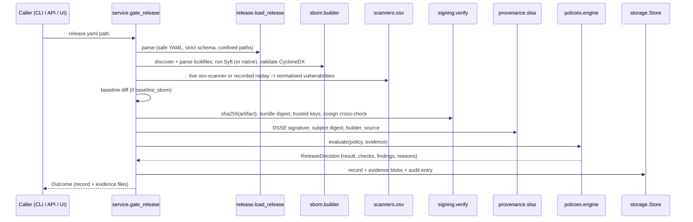

# Architecture

Sentinel is a single Python package (`sentinel/`) with three front ends (CLI, REST API,
dashboard) over one service layer. There are no microservices: every interface calls the same
functions in `sentinel/core/service.py`, so a decision made in CI, through the API or in the
dashboard is computed by identical code.

## Package layout

| Package | Responsibility |
|---|---|
| `sentinel/core` | Data models (`models.py`), settings, the hardened tool runner (`runner.py`), path/size/redaction controls (`security.py`), release record loader (`release.py`), orchestration (`service.py`) |
| `sentinel/sbom` | Manifest discovery and native lockfile parsers, Syft integration, CycloneDX parsing/validation/generation, dependency diff |
| `sentinel/scanners` | OSV-Scanner adapter: live execution, recorded replay, output normalisation |
| `sentinel/signing` | Key handling (dev workflow), Sigstore bundle parsing/signing, verification with Cosign cross-check |
| `sentinel/provenance` | DSSE encode/verify, in-toto/SLSA v1 statement validation and generation |
| `sentinel/policies` | Policy schema (strict pydantic) and the decision engine |
| `sentinel/reporting` | JSON and Markdown reports (redacted) |
| `sentinel/storage` | SQLite store: analyses, evidence blobs (with SHA-256), audit log |
| `sentinel/api` | FastAPI application |
| `sentinel/dashboard` | Streamlit app; `data.py` holds testable data shaping, `views/` the pages |
| `sentinel/demo.py` | Scenario catalogue runner and fault injection |

The spec suggested a top-level `app/` package; it was named `sentinel` instead so the installed
package name cannot collide with other projects' `app` modules.

## Release gate data flow

## Evidence model

Each run yields an `AnalysisRecord` containing the inventory (with SBOM metadata and
validation), the vulnerability scan (status, mode, scanner version, data source, limitations),
the dependency diff, signature and provenance verification results, the decision, tool versions
and a log. Evidence files (`sbom.cdx.json`, `vulnerabilities.json`, `dependency-diff.json`,
`signature-verification.json`, `provenance-verification.json`, `decision.json`, `report.md`,
`report.json`) are stored with their SHA-256; the decision lists those digests so a report can be
matched to the exact evidence it was based on.

Evidence modes are explicit:

| Mode | Meaning |
|---|---|
| `live` | the external tool ran during this analysis |
| `recorded` | tool output captured earlier and replayed (demonstrations, offline tests); always labelled |
| `native` | produced by Sentinel's built-in implementation (no Syft) |

## External tools

| Tool | Version tested | Used for | Fallback when absent |
|---|---|---|---|
| Syft | 1.55.0 | CycloneDX SBOM generation | Native lockfile parser + CycloneDX 1.6 generator |
| OSV-Scanner | 2.7.0 | Known-vulnerability lookup against OSV.dev | None: scan status `unavailable`, decision `INDETERMINATE` |
| Cosign | 3.1.4 | Signing fixtures; `verify-blob` cross-check | Native ECDSA P-256 verification of the same bundle format |

Syft output is post-processed: the project's own root package becomes the SBOM subject
(`metadata.component`) instead of a dependency, absolute host paths are replaced with `.`, and
direct/transitive scope from the native parsers is attached as `sentinel:dependency-scope`
properties only when ecosystem, name and version match exactly.

## Persistence

SQLite (`$SENTINEL_DATA_DIR/sentinel.db`) with three tables: `analyses` (summary columns plus the
redacted record JSON), `evidence` (blobs with media type and SHA-256) and `audit_log`. All SQL uses
bound parameters. The database is local state, not an evidence archive with integrity guarantees;
the optional Azure storage account (versioning enabled) is the place for retained evidence.
