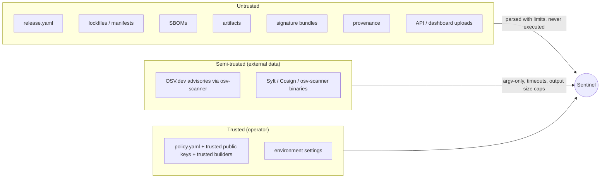

# Threat model

## What is protected

1. **The integrity of the release decision** - a release must not PASS unless the required
   evidence exists, was evaluated, and satisfies the policy.
2. **The host running Sentinel** - analysing a hostile project or upload must not execute code,
   read files outside the allowed area, or exfiltrate credentials.
3. **Secrets** - signing keys, passwords and tokens must not reach reports, logs, the database,
   screenshots or the repository.

## Trust boundaries

Key rule: **trust anchors only come from the policy file.** A release record has a strict schema
with no field for keys or builders (tested: an extra `trusted_keys` field is rejected), and a
signature bundle's key hint is treated as an unauthenticated label.

## Attacker model

| Attacker | Capability | Goal |
|---|---|---|
| Malicious or compromised dependency author | Publishes a package version | Get it shipped unnoticed |
| Insider / compromised CI step | Modifies the artifact or release record after build | Ship an artifact different from what was built and reviewed |
| External attacker | Supplies files to the API/dashboard (if exposed) | Path traversal, code execution, resource exhaustion, XSS |
| Network attacker / outage | Blocks OSV.dev | Make the scan fail silently and the release pass |

## Threats and mitigations

| # | Threat (STRIDE) | Mitigation | Verified by |
|---|---|---|---|
| T1 | Tampered artifact passes (T) | Signature verified over the **actual** SHA-256; bundle digest and pinned digest compared; provenance subject must match | `test_tampered_artifact_is_rejected`, `test_forged_digest_field_does_not_help`, scenario 04 |
| T2 | Signature from attacker key accepted (S) | Only policy keys are tried; key hint ignored for trust; Cosign must agree when installed | `test_untrusted_signer_is_rejected`, `test_release_record_cannot_add_trust_anchors` |
| T3 | Provenance for a different build reused (S/T) | Subject digest binding, DSSE signature, trusted builder list, source revision match | `test_provenance_for_a_different_artifact_is_invalid`, `test_tampered_payload_breaks_signature` |
| T4 | Scanner outage yields "no vulnerabilities" (R/D) | Scan status model; any non-completed required check → INDETERMINATE; exit 1 with no parseable results → error | `test_incomplete_scan_never_passes`, scenario 06 |
| T5 | Unknown severity treated as low (I) | `UNKNOWN` ranked separately; policy action `review` | `test_unknown_severity_requires_review` |
| T6 | Code execution via analysed project (E) | No build, install or script execution; `setup.py`/Gradle only detected | `test_discovery_reports_unsupported_and_never_executes` |
| T7 | Path traversal / symlink escape (I) | `resolve_within` after symlink resolution; allowed roots for API/UI; uploads renamed to safe basenames in a 0700 temp dir | `test_resolve_within_*`, `test_include_escaping_project_root_is_rejected`, API traversal tests |
| T8 | Shell injection via file names (E) | argv lists, `shell=False`, single runner | `test_runner_never_uses_a_shell` |
| T9 | Resource exhaustion (D) | Tool timeouts with process-group kill, output caps, JSON/YAML size limits, upload limits, walk limits | `test_runner_timeout_and_missing_binary`, `test_upload_size_limit`, `test_bounded_json` |
| T10 | Unsafe deserialisation (E) | `yaml.safe_load`; strict pydantic schemas | `test_release_yaml_must_be_safe_yaml` |
| T11 | Secret leakage (I) | Minimal tool environment; stderr/report/DB redaction; private keys refused as trust anchors; keys encrypted 0600; repo scan | `test_runner_does_not_forward_secrets`, `test_reports_never_contain_key_material`, `test_no_private_keys_committed` |
| T12 | SQL injection (T/I) | Bound parameters; ID format validation in the API | `test_store_queries_are_parameterised`, `test_unknown_or_malformed_ids` |
| T13 | XSS in dashboard via package names/advisory text (T) | All interpolated HTML escaped; data rendered through Streamlit components | code review (`ui.py` uses `html.escape`) |
| T14 | Weakened CI (E) | Read-only token, no `pull_request_target`, SHA-pinned actions, hash-pinned deps, checksum-verified binaries | workflow review |

## Residual risks

- **Compromised trusted key or builder.** If the demo key's private half had leaked, or a real
  signing key is stolen, signatures verify. Mitigate with KMS-held keys (Azure Key Vault design in
  Terraform), rotation and transparency logs (roadmap).
- **No transparency log.** Offline key-based signatures are not checked against Rekor.
- **Advisory coverage.** Unknown or undisclosed vulnerabilities, malicious packages without an
  advisory, and typosquats that are not in OSV are not detected; a new dependency is only flagged
  for review.
- **External tool trust.** Syft, OSV-Scanner and Cosign binaries are trusted once installed; CI
  pins and checksum-verifies them, local installs rely on the package manager.
- **Local database integrity.** SQLite history can be edited by anyone with file access.
- **Dashboard authentication.** None built in; do not expose it without an authenticating proxy.
- **Denial of service through very large but valid inputs** is bounded by limits, not eliminated.
